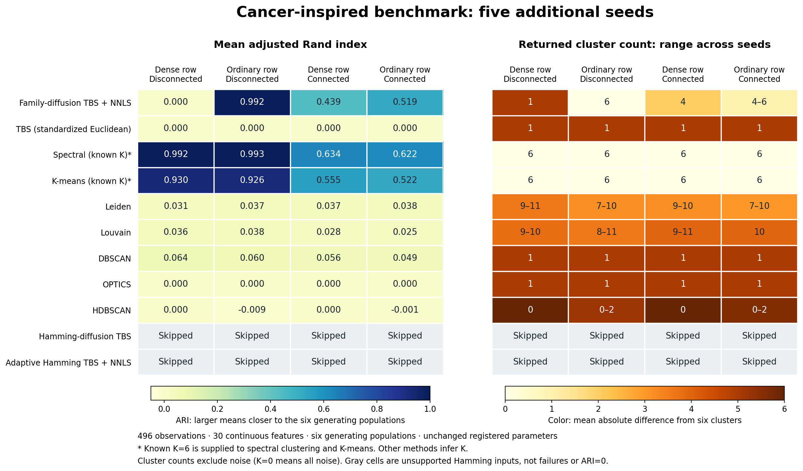
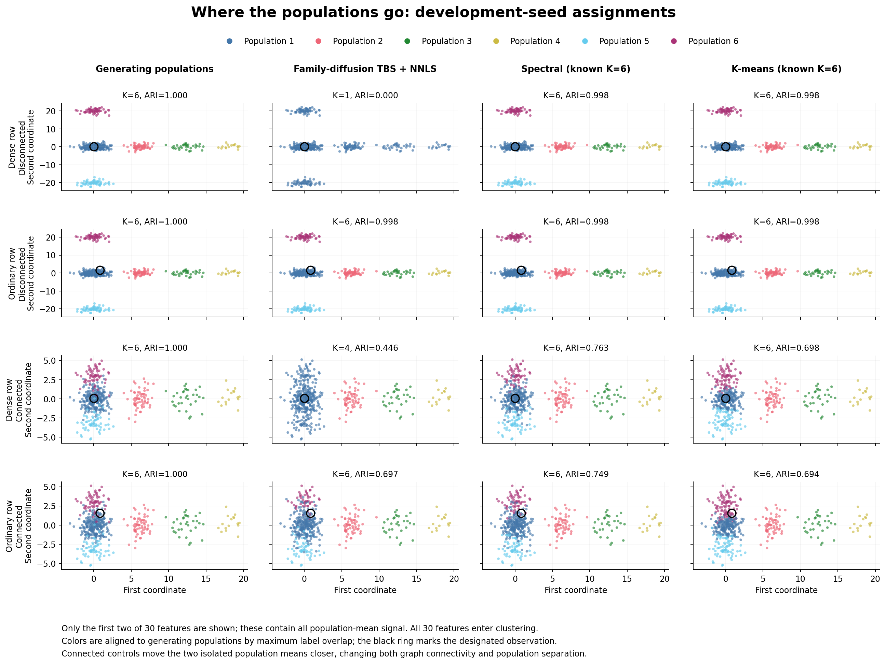

# Cancer-inspired benchmark: default methods and plots

Date: 2026-11-04. Four registered cases, six fixed seeds, eleven default methods.
The standard full-report entrypoint and the repeated panel use the same shared
case preparation, method registry, execution and metric code. No clustering
parameters, statistical thresholds or production inference implementations were
changed for this comparison.

## Results

There are 264 distinct case/seed/method rows: 216 successful runs and 48 explicit
skips. Both Hamming-based diffusion methods reject continuous inputs under their
registered contracts. The independent standard four-case report completes with
44 rows; these match the panel's development-seed rows in status, parameters,
ARI, NMI and cluster counts.

The table summarizes mean ARI across the five additional seeds, 20261105 through
20261109. Seed 20261104 is reserved for the development-seed assignment figures
and the native tree/UMAP report. The six generating populations and all 30
continuous features are unchanged from the preceding surrogate experiment.

| Method | Dense row, disconnected | Ordinary row, disconnected | Dense row, connected | Ordinary row, connected |
| --- | ---: | ---: | ---: | ---: |
| Family-diffusion TBS + NNLS | 0.0000 | 0.9922 | 0.4388 | 0.5185 |
| TBS, standardized Euclidean | 0.0000 | 0.0000 | 0.0000 | 0.0000 |
| Spectral, known K=6 | 0.9916 | 0.9928 | 0.6337 | 0.6219 |
| K-means, known K=6 | 0.9304 | 0.9262 | 0.5546 | 0.5216 |
| Leiden | 0.0306 | 0.0369 | 0.0368 | 0.0384 |
| Louvain | 0.0362 | 0.0380 | 0.0284 | 0.0248 |
| DBSCAN | 0.0638 | 0.0602 | 0.0564 | 0.0488 |
| OPTICS | 0.0000 | 0.0000 | 0.0000 | 0.0000 |
| HDBSCAN | 0.0000 | -0.0090 | 0.0000 | -0.0014 |
| Hamming-diffusion TBS | skipped | skipped | skipped | skipped |
| Adaptive Hamming TBS + NNLS | skipped | skipped | skipped | skipped |



## Interpretation

- Family-diffusion TBS returns one cluster for every dense-row disconnected
  seed and six for every matched ordinary-row disconnected seed. Its ordinary
  control ARI ranges from 0.986397 to 1. This preserves the known failure
  contrast when the cases pass through the full benchmark infrastructure.
- Spectral clustering retains the six disconnected populations in both row
  controls, with mean ARI near 0.992. K-means is less stable: its disconnected
  ARI falls to 0.6715/0.6448 in the lowest-performing paired seed despite always
  returning six clusters. Both methods receive the true K=6; this is a material
  advantage over methods that must infer K, not a general clustering ranking.
- TBS with standardized Euclidean topology returns one cluster in every case.
  Leiden and Louvain return 7–11 clusters across the additional seeds with low
  label agreement. DBSCAN and OPTICS return one non-noise cluster. HDBSCAN
  often assigns all observations to noise; K=0 in the figure means all noise.
  Noise labels participate in ARI calculation under the existing metric contract.
- Bringing the two isolated population means closer changes both connectivity
  and overlap. Lower connected-case ARI cannot be attributed to connectivity
  alone. In the development dense-row connected case, family-diffusion TBS
  merges the three populations near first coordinate zero and returns four
  clusters. The assignment plot makes that merge visible.

These are the registered pipeline comparisons, not comparisons under a common
distance or common knowledge of K. The case's standardized Euclidean distances
feed ordinary TBS, Leiden, Louvain and the density methods. Family diffusion
constructs its Euclidean adaptive graph on the original continuous coordinates,
then tests original-feature distributions. K-means and spectral clustering also
receive the original feature matrix. No method was retuned after seeing results.

## Assignment plots



Only the first two of 30 features are displayed; all population-mean signal
lies in these coordinates. All 30 features enter clustering. Colors are aligned
to generating populations by maximum overlap, without changing any assignments.
The ring identifies the single observation whose noise scale changes between
the dense and ordinary controls. Axes are shared within each case row.

The standard report contains 23 pages with trees and common UMAP embeddings:
[native benchmark report](generated/development/cancer_pc_benchmark_report.pdf).
The common UMAP view standardizes all features before embedding and therefore
does not depict the native family-diffusion geometry. The original-coordinate
assignment figure above provides a complementary, directly interpretable view.
Both summary figures also have vector PDF versions beside their PNG files.

## Integration and reproduction

The existing four cases remain in `full` and `method_proof`; the new `cancer_pc`
suite selects exactly those cases. The full registry now has 126 cases. The
default method set remains the existing eleven IDs in
`benchmarks/shared/util/method_sets.py`.

Run the standard report from the repository root:

```bash
TBS_CASE_SUITE=cancer_pc \
TBS_RUN_RELATIONSHIP_ANALYSIS=0 \
TBS_RUN_DIR=/tmp/cancer-pc-development \
uv run --no-sync --offline python -m benchmarks.full.run
```

Run the six-seed panel into a fresh output directory; the script sets the
existing single-thread runtime defaults before numeric imports:

```bash
PYTHONPATH=. uv run --no-sync --offline python \
  reports/cancer_pc_methods_20261104/run_panel.py /tmp/cancer-pc-panel
```

The retained plotting script reads `generated/panel/results.csv` and the saved
assignments. It performs no clustering fits:

```bash
PYTHONPATH=. uv run --no-sync --offline python \
  reports/cancer_pc_methods_20261104/plot_results.py
```

`generated/panel/manifest.json` freezes recipes, methods, parameters, package
versions and source hashes. `input-fingerprints.csv` identifies all 24 input
matrices. Per-case compressed files preserve sample order, truth and every
successful method's assignments. Compact summaries and figures are retained;
copies of the manifest and input fingerprints are retained at this study's root.
Bulk native reports, audits and assignments are catalogued as local generated
outputs. No external backup is claimed.

## Verification and limits

The new suite-selection test failed before registration, then passed with the
existing generator, case-contract and full-runner failure-handling checks.
The focused suite contains 24 passing tests. Ruff checks pass. The standard
report completed with exit code zero. Independent verification recomputes
assignment metrics and checks input/source hashes and agreement of the two
execution entrypoints; see `verification.json`.

Both custom figures were visually inspected and spacing corrected. Representative
native tree and UMAP pages were rendered and inspected. The benchmark does not
validate gene-count preprocessing, fitted cancer covariance, selective Type-I
error/FDR, exact event certification, or full-scale NNLS convergence. The dense
row remains heteroskedastic, outside the common-sigma conditional prototype.
