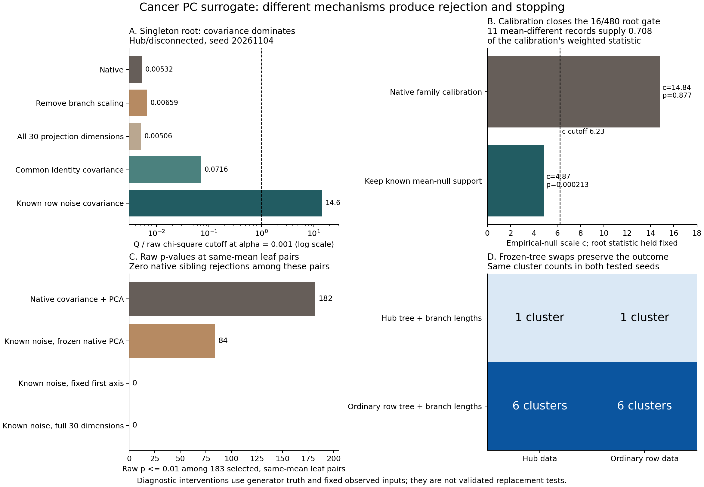

# Cancer PC surrogate: statistical rejection and closed-gate diagnosis

2026-11-04. Mechanism diagnosis on four registered cases and seeds 20261104
and 20261106, chosen to cover the previously observed singleton-edge and
16/480 sibling-gate failures. These are diagnostic cases, not new independent
validation replicates. No production inference, solver or preset is changed.

## Findings

There are **two opposing statistical effects**: covariance and projection fitted
from the tested observations can produce excessive raw rejection, while
empirical-null calibration using mean-different stopped subtrees can suppress
real signal. The selected topology and the mean-only target add separate
stopping mechanisms. Removing branch scaling or increasing root projection
rank does not resolve the two examined disconnected failures.



### 1. Raw sibling rejection: fitted covariance and fitted projection

In the hub/disconnected case at seed 20261106, 422 of 483 sibling records with
zero generating mean contrast have raw p-values below 0.01. Among its 183
same-mean two-leaf nodes, the corresponding counts are:

| Intervention at these fixed selected pairs | Raw p <= 0.01 |
| --- | ---: |
| Native covariance and native PCA | 182 / 183 |
| Known noise covariance, native PCA rows frozen | 84 / 183 |
| Known noise covariance, fixed first coordinate | 0 / 183 |
| Known noise covariance, full 30-dimensional norm | 0 / 183 |

These are dependent records selected within one tree, not an estimated
Type-I error rate. None becomes a native eligible sibling rejection.

The native two-leaf mechanism is explicit. With contrast
`delta = x_1 - x_2`, its parent diagonal sample covariance is
`diag(delta_j^2 / 2)`. Ignoring the small ridge, whitening makes the contrast
`sign(delta) / sqrt(F)`, where `F` is the sibling branch-variance multiplier.
The PCA row estimated from the same whitened pair is
`sign(delta) / sqrt(30)`. Thus **Q = 30/F**, although the reference uses df=1.
Across these 183 records, measured `Q*F` ranges from 29.999965 to 30.000000.
This is a fitted-reference problem, not evidence that all those pairs have
different generating means. PCA is constructed in null-whitened coordinates;
the known-noise intervention above keeps those native PCA rows fixed.

A separate Gaussian control removes tree selection, branch scaling and
covariance estimation. For a predetermined pair with known identity noise,
let `Z=(X_1-X_2)/sqrt(2) ~ N(0,I_30)` and estimate `u=Z/||Z||` from that pair.
Then `(u'Z)^2=||Z||^2 ~ chi-square(30)`, **not chi-square(1)**. Using df=1 at
alpha=0.01 has exact rejection probability 0.9999977401. In 10,000 reproducible
draws it rejects 10,000 times, versus 102 for a fixed coordinate and 112 for the
full-space chi-square(30) test. Ten native projected-Wald kernel replays match
the algebra. This establishes the reference mismatch in the isolated
construction; it is not the error rate of the full TBS pipeline.

### 2. Closed singleton root: covariance and a one-observation child

At seed 20261104, the hub/disconnected root has sizes 1/495. Its covariance
falls back to parent-total covariance, which includes population separation
and does not represent the designated row's known variance `0.03^2 I`.

| Single changed input | Singleton edge Q | df | Raw p |
| --- | ---: | ---: | ---: |
| Native | 0.287643 | 26 | 1 |
| Remove branch scaling | 0.356294 | 26 | 1 |
| All 30 projection dimensions | 0.302336 | 30 | 1 |
| Common identity covariance | 3.871214 | 26 | 0.9999999 |
| Exact known row-noise contrast covariance | 788.041436 | 26 | 2.28e-149 |

Both root edges pass with the last intervention. Identity covariance alone
does not suffice: the heterogeneous row variance matters. The oracle uses
generator information that cannot be estimated from this singleton alone.
Changing covariance does not establish a valid selected test or guarantee
six clusters; native sibling calibration remains fixed in these factor checks.

### 3. Closed 16/480 root: non-null contamination of calibration

At seed 20261106, both root edges reject, but sibling `Q=316.876330`, df=30 is
divided by `c=14.843856`, yielding p=0.876715. The root would open at sibling
alpha=0.01 only if c were below approximately 6.23, holding Q fixed.

Of 494 supported calibration records, **11 have nonzero generating mean
contrasts**. They contribute 0.708302 of the weighted-statistic numerator.
The largest record, N986 (64/319 leaves), has mean-contrast norm 20.0362 and
Q=20020.7733. It lies below a stopped edge and receives null weight one. Its
code role is "null-like"; its generating mean contrast is not null.

Holding the native family weights for the remaining known mean-null records
gives c=4.867973 and root p=0.000213350, opening this sibling gate.
Refitting the local kernel on that restricted support gives c=2.648967 and
p=1.18e-12. Replacing calibration-record covariance with known noise while
retaining contaminated support makes c worse (24.181169, p=0.996822).
Covariance repair alone therefore does not repair the calibration selection.

The native model has only two stopping-event dependency groups here, despite
494 records. All eight examined root calibrations fail existing internal
support thresholds when enforcement is enabled; the registered method disables
enforcement. Enabling it produces `undefined_sparse_context`, not a validated
rejection or a six-cluster solution. Setting c=1 or retaining only tested
null-role records opens this root but does not validate replacement calibration.

### 4. Tree dependence and a limitation of the tested hypothesis

Frozen-tree exchanges preserve one versus six clusters in both examined
disconnected seeds, regardless of whether the test data contain the dense
row. Each exchange retains **both topology and fitted branch lengths** and
reruns native covariance, projection, gates and traversal. This separates
the direct data perturbation from its effect through the fitted tree; it
does not isolate topology from branch lengths.

The connected hub case at seed 20261104 stops at N985, a 1/383 split within
a 384-leaf parent. That parent contains the 256-observation population at
zero and two 64-observation populations at second-coordinate means -3 and +3.
The singleton is the zero-mean hub; the remaining mixture also has mean zero.
The sibling generating mean contrast is exactly zero, with raw Q=0.089043
and p rounding to one. There are three populations below this node, but its
proposed split has **no mean signal**. Failure to open that split is not by
itself an erroneous decision under the mean-equality null. At seed 20261106
the analogous mixed-parent contrast is only 0.015625.

### 5. Actual rejections versus shadow calculations

Across eight native runs, Tree-BH marks 116 edges eligible and rejects 50;
the sibling frontier contains 25 tests and rejects 24. None of those rejected
contrasts has zero generating mean contrast. The raw same-mean p-values above
are mostly blocked/shadow calculations. These realized counts do not prove
selected-error control: the cases are signal mixtures chosen to diagnose
failure, and records within a tree are dependent.

## Consequences for a statistical repair

- Specify the target: a mean contrast at the observed split cannot detect all
  heterogeneous descendants, including symmetric mixtures with equal means.
- The reference law must account for covariance, projection and rank estimated
  from the tested observations, as well as tree selection. Known noise
  covariance alone leaves the selected-projection problem.
- A stopped subtree is not evidence for the null. Calibration needs a justified
  null source and sufficient independent information. Hundreds of descendants
  of one stopping event are not hundreds of independent calibration replicates.
- Preserve the one-tree requirement while deriving or independently validating
  these components. Oracle interventions diagnose the construction; they do
  not supply a production estimator or establish cancer-data validity.

## Questions and interventions

1. Does a small root statistic come from branch-length scaling, adaptive
   projection, or contrast covariance? Replay the actual edge inputs; change
   exactly one of these inputs while retaining the selected tree.
2. Does sibling calibration absorb mean differences from stopped subtrees?
   Classify each selected contrast using the generator's population means;
   measure its contribution to the empirical-null scale and refit after
   excluding mean-different records. Also preserve the native family weights
   and compute the restricted family scale without a new local kernel.
3. Does the designated observation change the outcome directly through the
   test data or through the fitted tree? Exchange data between the matched
   trees, keeping each tree's topology **and fitted branch lengths** frozen.
4. Which actual null-hypothesis rejections and traversal stops occur? Export
   all edge/sibling records and the native traversal, distinguishing raw
   statistics from eligible tests and live traversal decisions.

## Model and limits

For fixed contrast weights `a`, the generator gives
`Var(sum_i a_i X_i) = sum_i a_i^2 s_i^2 I`, where `s_0 = hub_scale`
and all other `s_i = 1`. Child-parent weights use the actual test halves;
sibling weights use all leaves. The diagnostic feeds the corresponding
effective common covariance into the unchanged native contrast calculation.
This identity is unconditional for fixed membership. It does not establish
the null law after the tree and projection have been selected from these data.
The separate common-identity intervention deliberately omits the hub's known
heteroskedasticity, to distinguish it from between-population covariance.

Root sibling factor checks keep the native empirical-null scale fixed. The
calibration-only checks keep the root statistic fixed. Neither is a refitted
clustering method. A root sibling record calculated below a closed edge is a
shadow diagnostic, not a native eligible sibling test. Frozen-tree swaps do
rerun the native gates and traversal and therefore produce cluster assignments.

The benchmark starts at the PC representation. It does not estimate cancer
covariance, reproduce preprocessing or establish selected Type-I error/FDR.
Generating population labels and a zero selected mean contrast are different
concepts: the latter is determined by the population-mean contrast itself.

## Reproduction

Use a fresh destination from the repository root:

```bash
PYTHONPATH=. uv run --no-sync --offline python \
  reports/cancer_pc_statistics_debug_20261104/run_diagnostic.py /tmp/cancer-pc-statistics-debug
```

The script reuses native generation, dispatch, projection, covariance,
calibration and traversal. Assertions check input/metric parity with the prior
24-run surrogate bundle, every raw sibling replay, root edge replay, contrast
weight variance and branch-scaling identities (within numerical tolerance),
matched frozen-tree results and source stability during execution.

Retained compact evidence: `summary.csv`, `root_factors.csv`,
`calibration_factors.csv`, `frozen_tree_swaps.csv`,
`fixed_pair_reference_check.json`, `verification.json`, `manifest.json` and
`independent_verification.json`. Detailed edge/sibling/pair/traversal records
and root calibration support are under `generated/complete/`, explicitly
classified as local generated output. Non-finite support diagnostics are
preserved as explicit JSON strings. They are not replaced by finite values.

`verify_results.py` independently checks 241 source hashes, recalculates all
120 root-factor p-values and the restricted family scale, checks 7,920 edge
and 3,960 sibling records, confirms the 183 pair identities, and reconstructs
the connected stopping node's population counts. `plot_diagnostic.py` reads
only saved outputs and records its input hashes. The final PNG was visually
inspected. Narrow generator/calibration tests: 59 passed. These implementation
checks do not establish statistical calibration.

```bash
uv run --no-sync --offline python reports/cancer_pc_statistics_debug_20261104/verify_results.py
uv run --no-sync --offline python reports/cancer_pc_statistics_debug_20261104/plot_diagnostic.py
```

Owning implementation paths are included in the manifest. The main boundaries
are the child-parent annotation's split test/basis rows; the spectral worker's
null-whitened PCA; `contrast_covariance.py`; the projected-Wald kernel's
rank-based chi-square reference; sibling record collection's stopped-edge
roles; the empirical-null inflation estimator; Tree-BH; traversal-aligned
sibling BH; and `TreeDecomposition`. All production sources remained unchanged
during this diagnostic. Pre-existing working-tree modifications, including
the family-baseline fallback in the inflation estimator, remain part of the
evaluated implementation.
