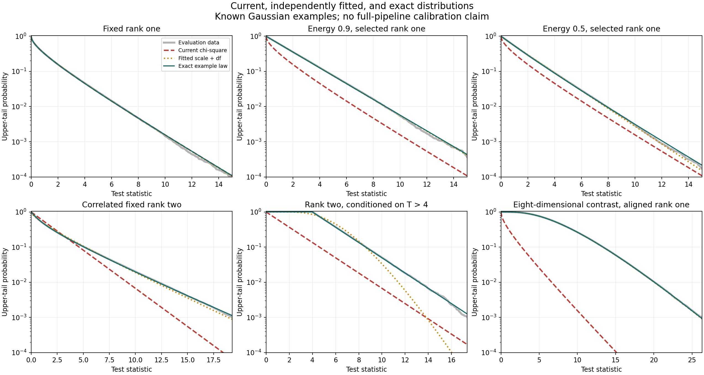

# Distribution equations and independent fitting comparison

The controlled examples identify separate effects of covariance, adaptive rank,
adaptive direction, and selection. An exact conditional equation is available
for the two-dimensional contrast-energy example. Adjusting degrees of freedom
alone does not generally give the correct distribution; even fitting scale and
degrees of freedom fails for the radial-selection example. These are diagnostic
results, not a calibrated replacement for the full selected-tree pipeline.

## Recovered methods

The earlier equation search is in
[`selected_hierarchy_geometry_covariates.py`](../../benchmarks/diagnostics/calibration/selected/hierarchy/selected_hierarchy_geometry_covariates.py).
Its response is `log_R`, where
`R = statistic / (reference_scale * degrees_of_freedom)`. It standardizes
predictors using training data and fits ordinary least squares. The six existing
candidate equations are:

| Identifier | Existing equation |
|---|---|
| `edge_action` | `log_R ~ A_edge` |
| `edge_sampling_geometry` | `log_R ~ A_edge + log(p/n_parent) + log(1/n_L+1/n_R) + child_balance` |
| `edge_spectral_modes` | `log_R ~ A_edge + log(lambda_k/lambda_MP) + spectral_mass + effective_rank` |
| `edge_angular_capture` | `log_R ~ A_edge + rho + top_component_cos2 + component_cos2_entropy` |
| `selected_energy_candidate` | `log_R ~ A_edge + log(lambda_k/lambda_MP) + rho + log(p/n_parent)` |
| `full_descriptive_candidate` | `log_R ~ A_edge + log(p/n_parent) + log(1/n_L+1/n_R) + log(lambda_k/lambda_MP) + spectral_mass + rho + component_entropy` |

The source defines the predictor mappings; these formula labels are preserved.
It implements replicate, case and source-family holdouts, and a separate
training-context empirical tail-quantile calculation. Recovered June 4 local
artifacts contain 271,798 finite fitting rows. The source-family holdout gives
`edge_spectral_modes` tail-ranking AUC 0.966050, but log-ratio R-squared only
0.062485. `full_descriptive_candidate` has R-squared -0.007705. These are
predictive summaries of selected ratios, not a fitted null CDF or proof of
p-value calibration. Overlapping nodes within a hierarchy are dependent;
row-level standard errors do not establish independent-hierarchy uncertainty.

[`historical_equation_holdout.csv`](historical_equation_holdout.csv) extracts all
six source-family comparisons from the existing local results. Of 79 historical
tail contexts, seven were marked admissible under that historical support
contract. This is not a current production promotion. The large merged raw
cloud table was not available locally and was not downloaded or rerun.

Two further existing constructions are relevant:

- [`infer_satterthwaite_reference_from_eigenvalues`](../../benchmarks/diagnostics/calibration/statistics/statistic_distribution_shape_panel.py)
  provides a diagnostic scale and effective-df moment approximation.
- [`compute_selected_gaussian_tail`](../../tree_break_selection/hierarchy_analysis/statistics/projection/selected_gaussian_radial.py)
  integrates a chi-radius law over a declared selection interval union. It is
  an internal conditional-tail prototype. Correct construction of that union
  for an inferred hierarchy is a separate problem.

## Fitting equation checked with Wolfram Alpha

For a candidate reference T approximately distributed as a times chi-square nu,
let m = E[T] > 0 and v = Var[T] > 0. Matching its first two moments gives

\[
a\nu=m,\qquad 2a^2\nu=v,
\qquad a=\frac{v}{2m},\qquad \nu=\frac{2m^2}{v}.
\]

[Wolfram Alpha solved these equations](https://www.wolframalpha.com/input?i=solve+a%2An%3Dm%2C+2%2Aa%5E2%2An%3Dv+for+a%2Cn).
This matches moments, not necessarily the distribution or its extreme tails.
For a known Gaussian quadratic form with positive weights w_i, the corresponding
formulas are a = sum(w_i squared)/sum(w_i) and
nu = sum(w_i) squared/sum(w_i squared). These weights belong to the null
quadratic form; parent spectral eigenvalues are not automatically those weights.

The new diagnostic compares nominal chi-square, df-only mean matching,
scale-only mean matching, scale-and-df moment matching, scale-and-df maximum
likelihood (Gamma with location fixed at zero), and the exact example law.
All fitted parameters use independent training observations. Diagnostic scales
may be below one; these alternatives are not the production inflation estimate
with its lower bound of one.

## Exact adaptive-energy equation

Take independent standard normal Z1 and Z2, a fixed identity projection basis,
and distinct supplied eigenvalues. Write X = Z1 squared, Y = Z2 squared,
S = X + Y and U = X/S. Then S has chi-square two distribution, U has
Beta(1/2, 1/2) distribution, and S and U are independent. Wolfram Language
verified the transformed joint density factors exactly into those densities.

The contrast-energy rule at fraction q retains K = 1 when U >= q and K = 2
otherwise. The reported statistic is T = X = S U for K = 1 and T = S for K = 2.
With b = arccos(sqrt(q)), the exact conditional upper-tail probabilities are

\[
\boxed{\Pr(T\geq t\mid K=1)
=\frac{1}{b}\int_0^b
\exp\!\left[-\frac{t}{2\cos^2\theta}\right]d\theta},
\qquad t\geq0,
\]

\[
\Pr(K=1)=\frac{2b}{\pi},\qquad
\Pr(T\geq t\mid K=2)=e^{-t/2}.
\]

The derivation uses U = cos-squared(theta): conditional on U >= q, theta is
uniform on [0,b]. Conditional on theta, T is cos-squared(theta) times
chi-square two. Thus rank one is recorded correctly, but its selected statistic
does not have the nominal chi-square one distribution. The rank-two branch
retains its chi-square two law because its selection depends only on U.

At q = .9, the rank-one probability is 0.20483276469913345. Its conditional mean
is 1.9323993258149016 and variance is 3.7413496095016414. Its population moment
fit therefore has a = 0.9680580922175331 and nu = 1.9961605004389248, despite
retained rank one. A fitted effective df describes a reference distribution;
it must not replace the actual projection dimension in geometry records.

[Wolfram Alpha independently evaluated the integral at t = 7](https://www.wolframalpha.com/input?i=integral+exp%28-7%2F%282+cos%28x%29%5E2%29%29%2Farccos%28sqrt%280.9%29%29+from+x%3D0+to+arccos%28sqrt%280.9%29%29),
giving 0.02679366463202124. Wolfram Language also checked the moments and ten
numerical checkpoints for the energy and correlated examples. Actual returned
results are saved in
[`wolfram-distribution-fitting-20260928.md`](../../raw/inbox/wolfram-distribution-fitting-20260928.md).
Wolfram checked the supplied mathematical construction; it did not certify the
production pipeline.

For a fixed orthonormal m-dimensional candidate basis and an isotropic Gaussian
contrast, this construction extends formally to squared directional shares
W distributed as Dirichlet(1/2,...,1/2), independent of S distributed as
chi-square m. Let C_k be the cumulative retained share and K the energy-selected
rank. Then

\[
\Pr(T\geq t\mid K=k)
=E\!\left[Q\!\left(\frac m2,\frac{t}{2C_k}\right)\mid K=k\right],
\]

where Q is the regularized upper incomplete Gamma function. Fixed complete
blocks of dimensions m_j have Dirichlet parameters m_j/2. This extension is a
scoped derivation, not implemented or benchmarked here. Same-data learned PCA,
estimated covariance and tree selection need additional conditioning; they
cannot be inserted into this equation without establishing its assumptions.

## Other exact example laws

**Correlated fixed rank two.** The diagonal-standardized quadratic statistic
can have law T = 1.8 Z1 squared + .2 Z2 squared, corresponding to correlation .8
before orthogonal diagonalization. Its exact survival is

\[
\frac2\pi\int_0^{\pi/2}
\exp\left[-\frac{t}{2(1.8\cos^2\theta+.2\sin^2\theta)}\right]d\theta.
\]

A full covariance whitening would change the statistic; here the comparison
holds the statistic fixed and checks its reference law.

**Radial selection at unchanged rank two.** For S distributed as chi-square two,
condition on S > 4. Its conditional survival is one for t <= 4 and
exp[-(t-4)/2] for t > 4. The df remains two, but the support changes. No
unshifted scaled chi-square can reproduce that support. The existing
`compute_selected_gaussian_tail` evaluates this law using radius interval
(2,infinity); four direct calls agree with the exact formula.

**Aligned rank one in eight dimensions.** Choosing the projection direction
Z/||Z|| from the tested standard normal vector gives T = ||Z|| squared,
with chi-square eight law. This is an illustrative adaptive-direction
counterexample, not the production PCA algorithm. Fitting works here because
the candidate family contains the true law; it does not justify using ambient
dimension as a general replacement df.

## Independent evaluation

Training seed 2026092806 generates 100,000 standard normal vectors; evaluation
seed 2026092807 generates 200,000 separate vectors. Cases share matched vectors.
Conditional selection leaves the sample sizes shown below. Parameters are fit
once per case/selected rank on training data, with no evaluation-data tuning.
The nominal rejection target in this table is **1%**.

| Example | Evaluation count | Nominal chi-square | Fitted scale + df (moments) | Exact law |
|---|---:|---:|---:|---:|
| Fixed rank one | 200,000 | 1.0155% | 1.0185% | 1.0155% |
| Correlated fixed rank two | 200,000 | 2.5960% | 1.1050% | 1.0220% |
| Energy .9, conditional rank one | 40,963 | 3.2664% | 0.9740% | 0.9643% |
| Energy .9, conditional rank two | 159,037 | 1.0262% | 1.0444% | 1.0262% |
| Energy .9, both ranks combined | 200,000 | 1.4850% | 1.0300% | 1.0135% |
| Energy .5, conditional rank one | 99,865 | 2.0267% | 1.0614% | 1.0094% |
| Radial selection S > 4 | 27,293 | 7.4818% | 2.4512% | 1.0369% |
| Aligned rank one, ambient eight | 200,000 | 57.7085% | 1.0165% | 1.0015% |

The exact-law column uses analytic conditional distributions evaluated
numerically, not distributions fitted to evaluation data. Monte Carlo rates
fluctuate around their population targets. CSVs provide counts and pointwise
95% Wilson intervals, not simultaneous intervals. For example, the combined
energy exact-law rate at alpha .05 is .0511 and its pointwise interval excludes
.05; this isolated Monte Carlo fluctuation among many comparisons is not a
proof against the analytically derived law.

At the stricter target alpha = .001, the **population rejection rate divided by
alpha**, evaluated under the exact example law using the frozen training fits,
is:

| Example | Scale + df moment fit | Scale + df maximum likelihood |
|---|---:|---:|
| Correlated rank two | 1.272 | 2.519 |
| Energy .9, conditional rank one | 1.031 | 1.010 |
| Energy .5, conditional rank one | 1.223 | 1.394 |
| Radial selection S > 4 | 7.364 | 12.365 |

These ratios are calculated from the exact survival at each fitted reference
threshold, rather than inferred from rare evaluation exceedances. They expose
actual tail error for these frozen fits. The complete alpha grid is .001, .005,
.01 and .05. The descriptive uniform-p KS distance is reported without a fitted
same-data goodness-of-fit significance claim.



## Remaining mathematical questions

1. The full conditioning event must account for the tree inference method,
   tested edge, projection selection, complete eigenvalue groups, traversal and
   any data-dependent decisions. The controlled examples isolate components;
   they do not establish that combined event.
2. Independent-data projections separate basis selection from testing, but
   estimated covariance and empirical sibling inflation still require a
   justified finite-sample or conditional law.
3. The recovered ratio regressions identify candidate covariates. Turning them
   into a distribution requires conditional tail validation on independently
   regenerated hierarchies, with source-family and geometry support checks.
4. Retained rank, covariance-derived effective df, and selection distortion
   need distinct records. Changing the df field alone loses these distinctions.
5. A candidate correction must be evaluated through full clustering on matched
   seeds/cases and multiple alpha values. This run does not resolve the
   selected-tree false-split or final clustering calibration claims.

## Reproduction and verification

From the repository root, with the already inspected environment:

```sh
.venv/bin/python reports/distribution_equation_comparison_20260928/compare_distributions.py
```

The environment was macOS ARM64, Python 3.11.12, NumPy 2.3.4, SciPy 1.16.3,
pandas 2.3.3, Matplotlib 3.10.7, pytest 8.4.2, Ruff 0.15.14 and uv 0.9.5.
Before modifications, the projected-Wald reference/kernel baseline passed
8 tests and the selected-Gaussian radial baseline passed 15 tests. The report
script passes Ruff. No production code or defaults were changed in this task.

The runner verifies 256 actual kernel rank/statistic results, four existing
radial-tail calls, ten Wolfram numerical checkpoints, and independent adaptive
quadrature at eight statistic values for each of three angular laws. Maximum
absolute difference from that quadrature was 1.11e-16. Source hashes match
before and after execution. The design records seeds, alpha values and hashes
before computation; it is a reproducibility record, not an external
preregistration. A rerun to improve output summaries and tail plotting used the
same seeds and is not an additional independent experiment.

Artifacts: [manifest](manifest.json), [design](pre_run_design.json),
[parameters](fitted_parameters.csv), [all comparisons](heldout_comparison.csv),
[combined ranks](rank_mixture_summary.csv), [curves](distribution_curves.csv),
[historical equations](historical_equation_holdout.csv), and
[vector figure](distribution_comparison.pdf).
