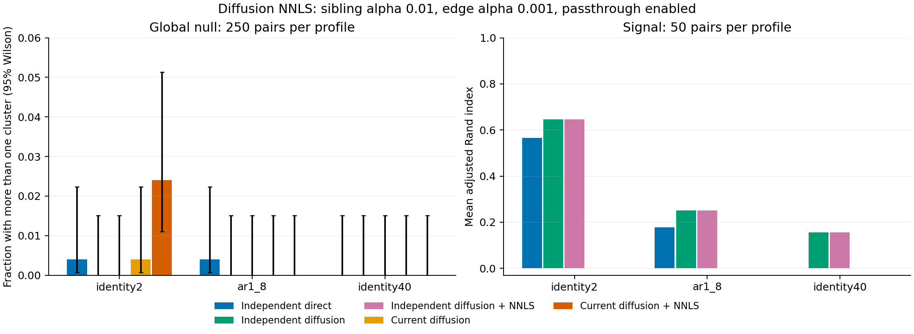

# Independent Gaussian diffusion and NNLS comparison

Discovery-only diffusion and fixed-topology NNLS are now supported by the
existing independent Gaussian production API. In 900 matched dataset pairs,
NNLS changed every branch-length fit but changed none of the 27,900 matched
node statistics, ranks or p-values. Diffusion changed topology and clustering
recovery. These are different effects under the known-covariance model.

## Production data flow

```python
from tree_break_selection.hierarchy_analysis.statistics.independent_gaussian import (
    IndependentGaussianDiffusion,
    fit_independent_gaussian_tree,
    test_independent_gaussian_tree,
)

model = fit_independent_gaussian_tree(
    discovery,
    known_covariance=externally_known_covariance,
    observation_ids=discovery_measurement_ids,
    diffusion=IndependentGaussianDiffusion(),
)
result = test_independent_gaussian_tree(
    model, inference, observation_ids=inference_measurement_ids,
)
```

Both matrices must measure the same leaves/features with independent Gaussian
noise, independent rows, and the supplied common covariance. Disjoint IDs and
hash checks reject obvious reuse; they cannot establish independence. The
default remains direct geometry when `diffusion` is omitted.

The new option reuses adaptive pydiffmap Euclidean diffusion, average linkage,
and fixed-topology NNLS. Diffusion and NNLS consume original discovery columns;
NNLS targets squared standardized Euclidean distances. PCA uses discovery
whitened by the known covariance. Inference refits none of these. Topology,
branch lengths, diffusion coordinates and PCA are frozen; changed branch
lengths/coordinates and nonconverged NNLS fits are rejected. Only linkage trees
are supported with this diffusion option.

For child sets A and B, the standardized test contrast is
`z = L^{-1}(mean_A - mean_B) / sqrt(1/n_A + 1/n_B)`, where
`L L^T = known_covariance`. Fitted NNLS lengths do not occur in that variance.
They therefore cannot affect this test on a fixed topology. The current
single-matrix method uses a different branch-time variance model, so NNLS can
change its results. Geometric branch lengths alone do not justify that
stochastic covariance model.

## Frozen evaluation

[Protocol](protocol.md): 250 null and 50 signal pairs per profile, 32 leaves,
three geometries, conditional versus nominal tails, sibling alpha .005/.01/.05,
edge alpha .001 and passthrough enabled. Signal means differ by two in the first
two coordinates. Profiles are identity covariance in 2 or 40 dimensions and
AR1(.6) covariance in 8 dimensions. Evaluation and pilot seed namespaces differ.

All 18,000 runs completed, with 83,700 node records, no skips/errors/warnings,
and unchanged source hashes during evaluation. All 2,700 fitted independent
contexts remained unchanged during testing. Diffusion-only and NNLS shared
identical topology, PCA and diffusion coordinates; all 900 NNLS branch fits
differed. The direct and diffusion topology hashes differed in all 900 cases.
Direct geometry uses known-covariance Euclidean distances; diffusion uses
Euclidean distances on original columns, an additional distinction under AR1.

## Primary results

At sibling alpha .01 and edge alpha .001:

| Profile | Null false partitions: independent direct | Independent diffusion / NNLS | Current diffusion | Current NNLS | Signal mean ARI: independent direct | Independent diffusion / NNLS |
|---|---:|---:|---:|---:|---:|---:|
| identity2 | 1/250 | 0/250 | 1/250 | 6/250 | .5663 | .6453 |
| ar1_8 | 1/250 | 0/250 | 0/250 | 0/250 | .1773 | .2512 |
| identity40 | 0/250 | 0/250 | 0/250 | 0/250 | .0000 | .1553 |

Independent entries use the conditional equation. Both current methods return
one cluster in all 150 signal cases at these settings. Those whole-method
comparisons also change measurement quantity, covariance treatment, rank
selection and empirical inflation; gains cannot be attributed to the equation.
The current dispatcher is overridden to Euclidean for Gaussian inputs; this is
not the default binary-Hamming preset.



The conditional equation alone changes 30 of 2,700 matched primary-alpha
geometry/case cluster-count outcomes; diffusion and NNLS are repeated identical
outcomes within that count, not independent replications. For diffusion/NNLS,
mean signal ARI changes from nominal .6443/.2972/.1865 to conditional
.6453/.2512/.1553 across the three profiles. Recovery does not uniformly improve.

Raw root rejection counts at cutoff .01, before gate corrections/traversal:

| Profile | Direct nominal → conditional | Diffusion nominal → conditional | NNLS nominal → conditional |
|---|---:|---:|---:|
| identity2 | 4 → 4 /250 | 4 → 3 /250 | 4 → 3 /250 |
| ar1_8 | 5 → 2 /250 | 3 → 3 /250 | 3 → 3 /250 |
| identity40 | 6 → 4 /250 | 7 → 6 /250 | 7 → 6 /250 |

The 40-dimensional diffusion conditional result is 6/250, rate .024,
pointwise Wilson interval [.0110,.0514], one-sided binomial p=.0412. This
pointwise deviation remains visible. No conditional cell rejects after the
prespecified 36-cell Holm correction (minimum adjusted p=1). This finite
non-rejection does not prove calibration. Zero final false partitions also
does not establish raw-tail validity: corrected edge gates and traversal can
block splits. Rare-tail precision and general whole-tree error control remain
unresolved.

## Solver and verification limits

All 900 NNLS fits reported success and were applied. Of these, 695 stopped on
relative cost change and 205 on first-order optimality. The optimality measure
has median 5.05e-5 and maximum .1517; success is not an exact NNLS optimality
certificate. Relative target RMSE has median .3322 and maximum .5682. Full
diagnostics are retained without changing solver settings after evaluation.

168 focused tests pass, including six diffusion/NNLS integration tests covering
discovery-only fitting, no inference refit, invariance, tamper rejection and
nonconvergence. Ruff and wiki lint are checked separately. This does not cover
binary diffusion, estimated covariance, dependent measurements, larger trees,
or a fitted branch-covariance model. Existing single-matrix callers retain their
input contract and calculation.

## Reproduction and artifacts

```sh
TBS_N_JOBS=1 OPENBLAS_NUM_THREADS=1 OMP_NUM_THREADS=1 VECLIB_MAXIMUM_THREADS=1 \
  .venv/bin/python reports/independent_diffusion_nnls_20260928/run_benchmark.py \
  --phase evaluation --workers 6 --output-dir /tmp/independent-diffusion-reproduction
.venv/bin/python reports/independent_diffusion_nnls_20260928/analyze_results.py
```

The output directory must not exist. `analyze_results.py` verifies the saved
`evaluation/` bundle. [Manifest](evaluation/manifest.json),
[run records](evaluation/runs.csv), [node records](evaluation/nodes.csv.gz),
[fitted contexts](evaluation/fitted_context.jsonl),
[root tails](evaluation/root_tails.csv), [summary](evaluation/summary.csv),
[equation effects](equation_effects.csv), [solver diagnostics](nnls_diagnostics.csv),
[verification](verification.json), and [figure PDF](comparison.pdf) retain the
matching keys and denominators. The pilot precedes a formatting-only change to
the runner; its separate source hashes record that earlier version.
