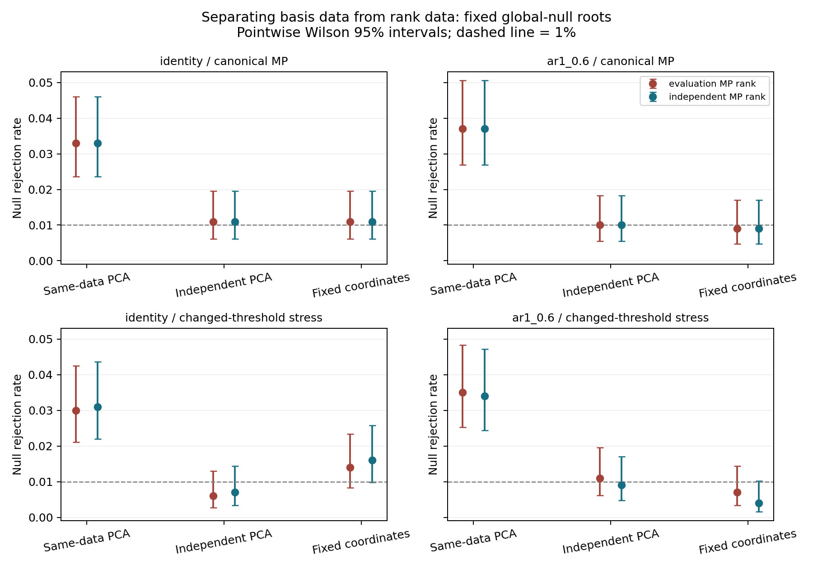
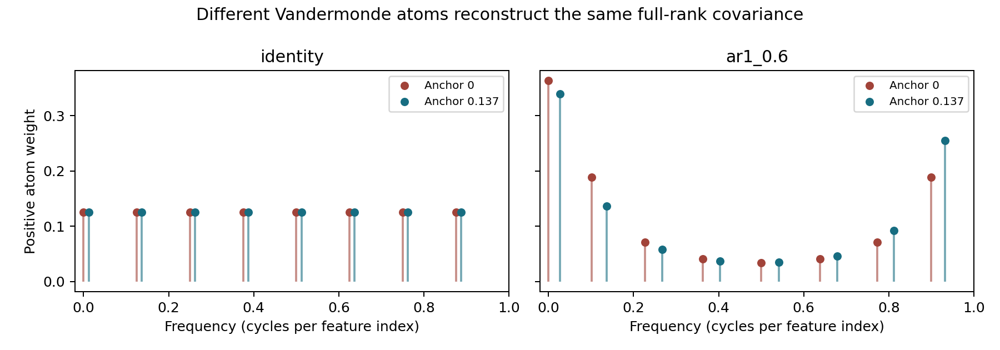

# Independent-data projection control and Vandermonde decomposition

The independent-data control isolates excess rejection from choosing PCA
eigenvectors on the evaluation data, even when rank is fixed at one. The
canonical global-null MP rank barely varies, so these cases cannot support a
separate rank-selection explanation. Vandermonde decomposition was applied
where its matrix conditions hold; it does not provide a unique replacement
for the PCA projection in this experiment.

## Independent-data experiment

The control runner was `benchmarks/diagnostics/calibration/sibling/independent_projection_control.py` (retired 2026-10-17; last present at commit 5c554bc5).
The [frozen control protocol](control_protocol.md) retains the original 10,000
evaluation datasets: five known branch patterns, two covariance profiles,
1,000 replicates per cell. It draws separate independent basis-training and
rank-training data, using the same population parameters and sample sizes.
This uses extra simulated data, not a production sample-splitting policy.

At each fixed R/A/B node, the design crosses three basis sources (evaluation
PCA, independent PCA, fixed coordinates) with five rank sources (evaluation
MP, independent MP, fixed 1, 2, 8). Known covariance and zero ridge are held
fixed. Actual rank includes complete numerical eigenvalue ties. A separate
global-null stress uses deliberately altered MP threshold rows to exercise
varying ranks. Its settings were fixed before the main run.

All **486,000 test rows** completed successfully. The 100-dataset pilot uses a
different base seed and is excluded. Each cell's uncertainty counts independent
datasets; overlapping R/A/B nodes are never pooled as independent trials.

At nominal alpha .01, global-null root comparisons with **rank fixed at one**:

| Basis | Identity | AR(1), correlation .6 |
|---|---:|---:|
| Evaluation-data PCA | 33/1000 = 3.3% [2.36, 4.60] | 37/1000 = 3.7% [2.70, 5.06] |
| Independent-data PCA | 11/1000 = 1.1% [0.62, 1.96] | 10/1000 = 1.0% [0.54, 1.83] |
| Fixed coordinates | 11/1000 = 1.1% [0.62, 1.96] | 9/1000 = 0.9% [0.47, 1.70] |

Brackets are pointwise Wilson 95% intervals, in percent. The matched
evaluation-minus-independent PCA differences are **2.2 percentage points**
(descriptive paired normal interval 1.00–3.40) and **2.7 points** (1.49–3.91).
Since rank is identical in these comparisons, rank selection is not required
to produce the observed distortion. These are controlled comparisons, not a
claim that projection choice explains every production failure.



Canonical evaluation MP chooses rank one at every global-null node (6,000
node tests). Independent MP differs on just three node datasets, choosing
rank two, without changing rejection outcomes. Thus making rank independent
while retaining same-data PCA does not remove the global-null excess here.
Independent basis plus independent rank gives R/A/B rejection counts
11/9/13 for identity and 10/6/10 for AR, each out of 1,000.

Mixed-null roots in `separate_deep_branches` have ranks one through three.
The threshold-rows stress exercises ranks one through five. In its global-null
roots, holding basis fixed and changing rank source gives rate differences
between -.002 and .003; all six paired normal intervals include zero. These
finite results do not identify a consistent rank-selection effect or rule out
one elsewhere. The stress changes the MP threshold and is not a proposed fix.

For a null Gaussian contrast z with covariance I, a projector selected entirely
from independent data gives a chi-square squared projected norm conditional
on those independent data, using its actual rank. Full fixed rank gives the
same statistic under every orthonormal basis. This latter invariance is an
unconditional statement; it does not justify conditioning on arbitrary
evaluation-data selections. Estimated covariance, selected trees and empirical
inflation remain outside this control.

The [summary](control_evaluation/summary.csv) separates signal power, null
tails, rank distributions and statistic skew with df-mixture references.
[Paired summaries](control_evaluation/paired_summary.csv) and compressed
individual rows retain all matched comparisons, including unavailable-status
fields. Zero-discordance normal intervals are descriptive, not equivalence
proofs.

## Vandermonde application

The [Vandermonde protocol](vandermonde_protocol.md) and
[guarded implementation](../../benchmarks/diagnostics/spectral/vandermonde.py)
use the PSD Toeplitz construction of
[Yang and Xie, Theorem 1](https://arxiv.org/abs/1605.02431).
It writes T = A diag(w) A^H with positive weights and sinusoidal atoms.
Rank-deficient cases have an identifiable decomposition; full-rank cases
permit different frequency sets. Local source notes are saved in
`raw/inbox/vandermonde-reference-notes-20260928.md`.

Applied to the exact identity and AR population covariances, anchors 0 and
.137 produce different eight-atom decompositions of the same matrices.
Known complex and real conjugate-pair rank-two controls recover their atoms.
All eight supported application cases reconstruct with relative Frobenius
error at most **6.22e-15**; four representative non-Toeplitz sample matrices
are explicitly unsupported. Frequencies, weights and residuals are saved in
[atoms](vandermonde/atoms.csv) and [decompositions](vandermonde/decompositions.csv).



Across the original 10,000 datasets, each fixed-root matrix was checked:

| Matrix | Passing PSD Toeplitz checks | Toeplitz residual range |
|---|---:|---:|
| Sample pooled covariance | 0/10000 | .0841–1.5078 |
| Known-covariance-whitened PCA covariance | 0/10000 | .1556–1.6315 |
| Sample-covariance-whitened PCA covariance | 10000/10000 | 1.13e-16–2.61e-15 |

The final matrix is a scalar identity by construction. Its decomposition
therefore supplies no unique dimension-reducing directions. No covariance
was silently fitted or projected onto the Toeplitz class. The frequency
interpretation also depends on the declared feature order; arbitrary feature
permutations do not generally preserve Toeplitz structure.

Vandermonde frequencies and weights are **not covariance eigenvalues**, and
its atoms are **not generally covariance eigenvectors**. In the AR examples,
normalized atom overlaps reach .227 and .288. Raw atom columns therefore
cannot replace an orthonormal Wald projection. After QR orthonormalization,
the atom span agrees with the positive covariance eigenspace: maximum
principal angle is below 1.24e-13 degrees and projector Frobenius difference
below 3.15e-15. Full-rank span agreement is automatic; it identifies no
preferred cluster or projection. Numerical rank and uniqueness labels use
the stated tolerance, not an exact-rank certificate.

## Verification and reproduction

The [independent verifier](verify_and_plot.py) regenerated **30,000 input
streams**, matched **30,000 original node tests**, checked **486,000 chi-square
calculations** and **486 summary cells**, and independently reproduced
**1,944** representative projections and MP ranks using NumPy matrix formulas.
All **117 frozen source hashes** and output hashes matched.
See [verification.json](verification.json). Vandermonde input hashes match the
original datasets, reconstruction checks pass, and its own before/after source
hashes match. Both figures were visually inspected. An independent
Vandermonde review found no actionable defects and checked 12 additional
nonorthogonal exact controls, with worst reconstruction error 4.35e-15.
`make check` passed all 712 tests, lint and dependency/dead-code audits;
wiki validation was rerun after the final documentation updates.

The protocol and evaluation remain unchanged. New diagnostics do not change
production code or defaults. No dependency installation, commit or push was
performed. The control runner was retired on 2026-10-17; recover it from git
history at commit 5c554bc5 to rerun the control.

The Vandermonde application command is:

```bash
uv run --no-sync python -m benchmarks.diagnostics.spectral.apply_vandermonde_diagnostic \
  --reference reports/known_branch_skew_20260928/evaluation \
  --output-dir reports/new-vandermonde-application \
  --protocol reports/independent_projection_vandermonde_20260928/vandermonde_protocol.md
```

## Open questions

- How does independent-data projection behave with estimated covariance,
  finite data splitting, categorical observations and selected trees?
- Can rank-selection effects be identified under canonical MP in regimes
  with substantial null-rank variability and adequate simulation precision?
- Does a real feature ordering justify a Toeplitz covariance model? Fitting
  one would be a separate modeling change requiring its own validation.
- How should any lower-dimensional Vandermonde atom subspace be chosen
  independently of the tested contrast when full-rank decompositions are
  nonunique? This experiment supplies no justified selection rule.
