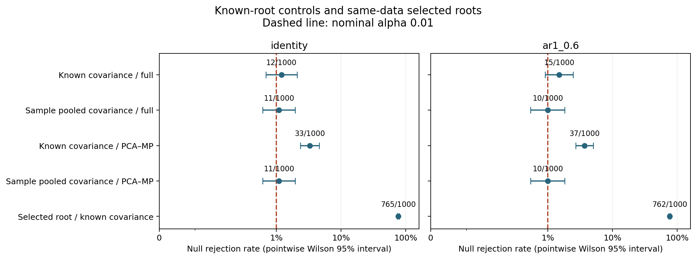

# Known-branch skew diagnostic

The controlled experiment identifies two distinct sources of excess null
rejections: same-data PCA/MP under known covariance, and selection of the tree
root from the same observations. Traversal also determines whether a strong
descendant can be reached through a null ancestor. This is a bounded Gaussian
implementation of the June 4 plan, not a repair or validation of the full
production pipeline.

## Design and primary evidence

The source plan is `raw/inbox/recursive-method-program-20260604.txt`: Q10
(lines 141–176), Q17 (239–263), Q19 (265–289), and Q24–Q25 (329–363).
The [frozen protocol](protocol.md) specifies the exact mean vectors, null
contrasts, covariance matrices and comparisons. Q19's ablation structure is
reused here; its categorical experiments are still outstanding.

The main run uses 1,000 independent datasets in each of five branch patterns
and two covariance profiles: **10,000 datasets**, each with four groups of 32
observations in eight dimensions. Each dataset supplies all matched variants.
The fixed tree is `R -> (A,B)`, `A -> (A0,A1)`, `B -> (B0,B1)`.
The patterns are global null, root-only signal, signal only below A, separate
signals below A and B, and strong root with weak signal below A.

The 50-dataset pilot is excluded from evaluation. All 120,000 local tests,
10,000 selected-root tests and 20,000 traversals completed successfully;
there were no unavailable outcomes. Output rows retain status and failure
fields for runs where those outcomes occur.

## Where the null rejection rates change

At nominal alpha **1%**, the all-null root results are:

| Root construction | Identity covariance | AR(1), correlation 0.6 |
|---|---:|---:|
| Fixed root, known covariance, full coordinates | 12/1000; 1.2% [0.69, 2.09] | 15/1000; 1.5% [0.91, 2.46] |
| Fixed root, sample pooled covariance, full coordinates | 11/1000; 1.1% [0.62, 1.96] | 10/1000; 1.0% [0.54, 1.83] |
| Fixed root, known covariance, same-data PCA/MP | 33/1000; 3.3% [2.36, 4.60] | 37/1000; 3.7% [2.70, 5.06] |
| Fixed root, sample pooled covariance, same-data PCA/MP | 11/1000; 1.1% [0.62, 1.96] | 10/1000; 1.0% [0.54, 1.83] |
| Same-data average-linkage root, known covariance, full coordinates | 765/1000; 76.5% [73.77, 79.02] | 762/1000; 76.2% [73.46, 78.74] |

Brackets give pointwise Wilson 95% intervals, in percent. They are not
simultaneous intervals. Each denominator counts independent datasets, not
overlapping tree nodes. The selected root has different membership from the
fixed root; under the global null both still have a population-null contrast.



The paired projection comparison under known covariance gains 25 and loses
4 rejections with identity covariance, and gains 30 and loses 8 with AR(1).
These are net increases of 2.1 and 2.2 percentage points on the same datasets.
Their paired standard errors are 0.53 and 0.61 percentage points.
See [paired stage summaries](paired_stage_summary.csv) and
[individual matched comparisons](paired_stage_rows.csv).

The covariance/projection interaction matters. Whitening the raw pooled data
with its own sample covariance produces a tied spectrum. Complete tie-group
retention consequently uses all eight dimensions in every sample-covariance
PCA/MP row. It gives the same rejection decisions as full coordinates across
the entire panel. The known-covariance PCA/MP rows use rank one at global-null
roots, and ranks one through three over the full panel. Thus the sample-
covariance result does not establish validity of a dimension-reducing
same-data projection. The sample pooled covariance includes between-child
mean variation; it is not within-child residual covariance.

Raw-statistic skew and tail miscalibration are separate measurements. For the
known-covariance global-null root, observed statistic skew changes from
1.197/1.177 (identity/AR) with eight degrees of freedom to 3.723/2.870 with
PCA/MP and one degree of freedom. The central chi-square reference skews are
1 and 2.828 respectively. Much of this shape change follows the changed
degrees of freedom; the excess lower-tail p-value mass is the clearer failure
here. Null-only skew and appropriate df-mixture references are saved in the
[evaluation summary](evaluation/known_branch_summary.csv).

## Where traversal changes recovery

These comparisons inject known-covariance, full-coordinate local tests into
production sibling BH and TreeDecomposition, with every edge prerequisite
deliberately open.

- Under the global null, any reached false split occurs in 12/1000 and
  15/1000 datasets without pass-through, and 20/1000 and 23/1000 with
  pass-through (identity/AR). The exact reference probabilities for this
  balanced three-test experiment are 1% and 1.99%, respectively. All four
  pointwise intervals include their relevant reference.
- With signal only below A, the A local test rejects in every dataset.
  Without pass-through, it is reached and split in only 11/1000 and 12/1000
  datasets because the null root blocks access. With pass-through, A is
  reached and split in all 1,000 datasets in both profiles. The root
  pass-through is not counted as a false `split`.
- With strong root and weak A, the root always splits. A's local rejection
  count at alpha .01 is 81/1000 and 281/1000; sibling BH reduces actual
  A splits to 51/1000 and 213/1000. Pass-through does not change these counts.

The [node recovery summary](node_recovery_summary.csv) includes per-node
reach, split, pass-through counts, Wilson intervals and mean terminal-group
partition counts. These partitions concern the four declared groups, not a
clustering-quality score over individually inferred observation leaves.

## Verification and reproduction

The [independent verifier](verify_and_plot.py) regenerated all 10,000 inputs
and hashes; recomputed 30,000 fixed-node and 10,000 selected-root oracle
quadratic forms; verified exact selected-root group-count truth; checked
130,000 chi-square p-values; and independently reconstructed all 20,000
three-node BH/traversal outcomes. It checked 17 current source hashes against
the saved manifest. [Verification record](verification.json).

Source hashes were saved at bundle writing, not before evaluation. There is
no separate pre-run snapshot proving source immutability throughout the run.
The direct regeneration and arithmetic checks provide independent output
validation; they do not supply a general calibration theorem.

`make check` passed lint, dependency/dead-code audits, wiki lint and all 697
ordered tests, including four new diagnostic tests. The final figure was
visually inspected. Production code and defaults were not changed by this
diagnostic task. Existing worktree changes were preserved; no commit or push.

From the repository root, use a fresh output directory:

```bash
uv run --no-sync python -m benchmarks.diagnostics.calibration.sibling.known_branch_skew_diagnostic \
  --output-dir reports/known_branch_skew_rerun \
  --replicates 1000 --base-seed 20260928 --n-per-group 32 --dimension 8 --alpha 0.01
```

Recheck the saved evaluation and regenerate its summaries/figure:

```bash
.venv/bin/python reports/known_branch_skew_20260928/verify_and_plot.py
```

The [manifest](evaluation/manifest.json) records the actual command, settings,
versions, dirty worktree and source hashes. Existing output directories are
protected against replacement.

## Remaining questions

Categorical/Bernoulli covariance, diffusion and NNLS, other tree inference
methods, estimated edge prerequisites, empirical inflation, and a general
selected-tree error-control guarantee remain untested by this experiment.
The large selected-root failure here locates a concrete selection problem;
it does not explain every failure in the earlier full-pipeline reassessment.
The projection comparison combines same-data eigenvector selection and MP
dimension selection; an independent-data projection control is still needed
to separate their contributions. This run tests covariance eigenspaces and
does not extend the earlier left/right nonnormal eigenvector analysis.
