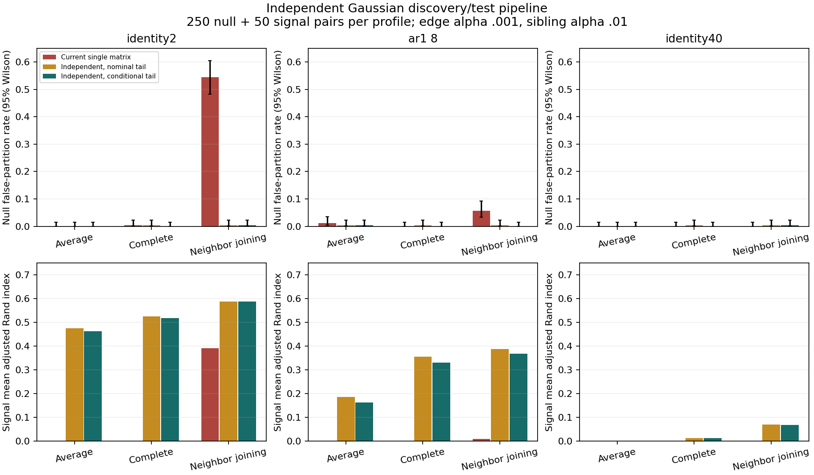

# Independent-data Gaussian p-value replacement and benchmarks

Implemented an explicit production fit/test path that learns the tree and PCA
from discovery measurements, then tests independent measurements of the same
leaves using the conditional energy equation. This satisfies the equation's
assumptions under the declared independent-row Gaussian model with externally
known common covariance. It does not relabel ordinary single-matrix input as
independent. Those existing callers remain unchanged because they lack the
required independent measurements and known covariance.

## Production entry points and data flow

- `tree_break_selection/hierarchy_analysis/statistics/independent_gaussian.py`
  (removed 2026-10-18; last present at commit 8415ca8a)
  contains `fit_independent_gaussian_tree` and `test_independent_gaussian_tree`.
- `tree_break_selection/hierarchy_analysis/statistics/projection/projected_wald/energy_selected_reference.py`
  (removed 2026-10-18; last present at commit 8415ca8a)
  evaluates the conditional energy-selected reference, including complete
  numerical eigenvalue groups and more than two candidate dimensions.

```python
from tree_break_selection.hierarchy_analysis.statistics.independent_gaussian import (
    fit_independent_gaussian_tree,
    test_independent_gaussian_tree,
)

model = fit_independent_gaussian_tree(
    discovery_df,
    known_covariance=population_covariance,
    observation_ids=discovery_measurement_ids,
    tree_builder="linkage",
    linkage_method="average",
    energy_fraction=0.9,
)
result = test_independent_gaussian_tree(
    model,
    independent_measurement_df,
    observation_ids=inference_measurement_ids,
    alpha=0.01,
    edge_alpha=0.001,
)
# result.tests, result.annotations, result.decomposition
```

Each matrix has the same leaf/feature identities and ordering. Measurement IDs
must be disjoint, since they identify observations, not leaves. The code rejects
reused IDs, identical matrices, mismatched labels and invalid covariance. These
checks cannot prove statistical independence: genuine independent measurements
and externally known covariance are scientific input requirements. Splitting
rows gives different leaves and does not meet this paired-measurement contract.

Discovery-only known-covariance whitening, tree construction and eigendecomposition
reuse the existing framework. Test contrasts use the frozen PCA spaces and known
covariance. The new equation replaces nominal adaptive-rank p-values before both
edge and sibling corrections. No same-data empirical inflation is fitted or
allowed to overwrite the new p-values. Existing Tree-BH, traversal-aligned
sibling BH and `TreeDecomposition` are reused. Under this common-covariance
binary-group model, normalized child-parent contrasts equal the sibling contrast
up to sign, so the two child edge p-values coincide. Fitted branch lengths are
not treated as known stochastic covariance times.

A fixed candidate rank has the usual chi-square reference. Adaptive rank has
an energy-selected mixture. Actual projection dimension is preserved; the
reference-law name and the meaning of the legacy degrees-of-freedom annotation
column are explicit. No fitted effective df is substituted for geometric rank.

## Equation implemented

For m independent standard normal projected coordinates in a discovery-fixed
basis, let S be total squared radius, C_k the fraction retained by the first k
coordinates, and h the previous complete eigenvalue-group boundary. Then S is
chi-square m independently of the directional energy shares. Selecting complete
rank k at energy fraction q means C_h < q <= C_k. For k < m the conditional
density of C_k is proportional, on [q,1], to

\[
 c^{k/2-1}(1-c)^{(m-k)/2-1}
 I_{q/c}\!\left(h/2,(k-h)/2\right),
\]

where the last factor is one for h = 0. Its normalized expectation of
Q(m/2, t/(2c)) gives P(T >= t | selected rank k). For k = m the statistic is
S, and the selection is directional, so the reference remains chi-square m.
At q = 1 a partial-rank event has probability zero and is rejected.

The two-dimensional case reduces to the earlier Wolfram-checked angular
integral. General integration uses Gauss-Jacobi quadrature with the substitution
c = q + (1-q)u squared to resolve both endpoints. Successive orders must agree;
unresolved numerical integration raises an error rather than returning a
nominal fallback. The model covers fixed complete numerical groups, without
interpreting numerical ties as exact algebraic multiplicities.

## Benchmark design and results

The [protocol](protocol.md) was fixed before evaluation. Seed 2026092811 is
separate from the implementation pilot. The evaluation draws **900 paired
datasets**: 250 null and 50 signal pairs for each of identity covariance in two
dimensions, AR1(.6) covariance in eight dimensions, and identity covariance in
40 dimensions, with 32 leaves. Seven linkage methods and neighbor joining are
attempted. Both independent variants use exactly the same tree, PCA basis,
statistic and inference measurements; only the p-value reference changes.

There are 24,300 method/variant/alpha rows:

| Variant | Completed | Unsupported tree | Unexpected errors |
|---|---:|---:|---:|
| Independent conditional equation | 9,267 | 1,533 | 0 |
| Independent nominal chi-square | 9,267 | 1,533 | 0 |
| Current single-matrix dispatcher, three methods | 2,700 | 0 | 0 |

Unsupported cases arise from the existing centroid/median constructor rejecting
nonmonotone merge heights. They are not counted as successful null results.
The two independent variants have exactly matched statuses and denominators.
There are 175,677 recorded node tests. Multiple methods and alpha settings on
one dataset are correlated repeated comparisons, not extra independent datasets.

At the **1% raw root-p-value cutoff**, these are null rejections out of 250:

| Covariance profile | Tree method | Independent nominal | Independent conditional |
|---|---|---:|---:|
| Identity, dimension 2 | Average | 1 | 0 |
| Identity, dimension 2 | Neighbor joining | 5 | 2 |
| AR1, dimension 8 | Average | 3 | 2 |
| AR1, dimension 8 | Neighbor joining | 8 | 5 |
| Identity, dimension 40 | Average | 5 | 1 |
| Identity, dimension 40 | Neighbor joining | 8 | 8 |

The last row is an important limitation of this finite benchmark: its observed
rate is 3.2% at a 1% target. The one-sided binomial p-value is .004025. A
post-evaluation Holm diagnostic over the 96 planned profile/method/cutoff
comparisons gives .386433; none reject at .05 after that adjustment. This does
not prove calibration or erase the pointwise deviation. Each method/profile
has only 250 independent null datasets, so rare-tail precision is limited.
[Root rates and intervals](evaluation/root_tails.csv) and
[the multiplicity diagnostic](root_calibration_check.csv) retain those results.

At sibling alpha .01, changing the equation changes cluster counts in 32 matched
method/dataset outcomes. Signal recovery is not uniformly improved: for AR1
neighbor joining, mean adjusted Rand index moves from .3883 (independent nominal)
to .3682 (independent conditional). High-dimensional recovery remains weak
(.0704 to .0679). Correcting a reference law is not equivalent to maximizing
clustering recovery.

The current single-matrix comparison is a **whole-method comparison**: the new
path also receives independent additional measurements and known covariance.
For example, two-dimensional null neighbor-joining false partitions fall from
136/250 to 1/250, while signal mean adjusted Rand index rises from .3911 to
.5873. These changes cannot be attributed to the conditional equation alone;
independent nominal already gives 1/250 false partitions and mean ARI .5872.



A separate [unchanged-method baseline](baseline/manifest.json) ran 420 datasets
across the earlier six feature families and five methods: 2,380 method/alpha
runs, 1,960 completed and 420 explicitly skipped, with no runtime or audit
errors. It provides current behavior across those families; it does not extend
the new Gaussian API to Bernoulli/categorical or binary diffusion cases.

## Verification and remaining limits

- 146 focused tests passed across the projected-Wald kernel, reference laws,
  eigenspace invariance, empirical inflation, sibling FDR and the new API. The
  new module contributes 24 tests, including data-reuse rejection, frozen
  projections, dual PCA, Wolfram's two-dimensional checkpoint and independent
  Gaussian sampling checks for higher-dimensional complete-group selection.
- The pilot exposed an endpoint-convergence problem in direct quadrature; the
  squared-coordinate substitution fixed it before evaluation. No equation,
  threshold or parameter was selected using evaluation outcomes.
- Twelve independent SciPy adaptive-integral checks agree with the production
  quadrature to maximum absolute difference 7.11e-15. Source hashes match;
  10,800 independent-variant pairs were validated, including 9,267 completed
  pairs. Output counts, root/node joins and p-value ranges were checked.
- Ruff passes for the new production modules, test module and report scripts.
  The wiki records this explicit Gaussian path and its limits.
- Known covariance, genuine paired independence and Gaussian measurements are
  still required. Estimated covariance, unavailable replicate measurements,
  dependent observations and non-Gaussian distributions need separate methods.
  This work does not silently replace existing single-matrix application calls.

No installation, commit or push was performed. Pre-existing worktree changes
were preserved.

## Reproduce

```sh
TBS_N_JOBS=1 OPENBLAS_NUM_THREADS=1 OMP_NUM_THREADS=1 VECLIB_MAXIMUM_THREADS=1 \
  .venv/bin/python reports/production_pvalue_replacement_20260928/run_independent_benchmark.py \
  --workers 6 --output-dir reports/production_pvalue_replacement_20260928/new_evaluation
```

Use a fresh output directory; populated evaluation output is not overwritten.
See [evaluation manifest](evaluation/manifest.json), [summary](evaluation/summary.csv),
[paired differences](paired_comparison.csv), [verification](verification.json),
[plot PDF](benchmark_comparison.pdf), and [verification/plotting script](summarize_results.py).
