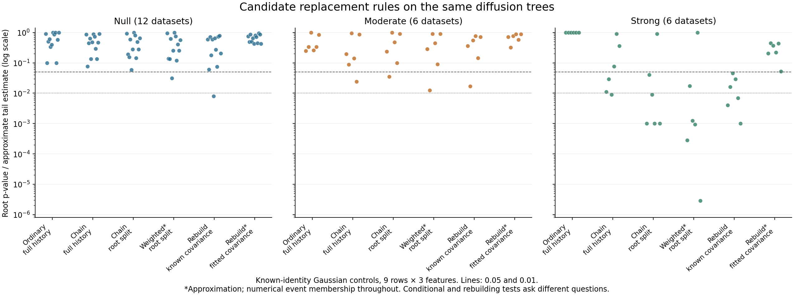

# Conditional selective inference and whole-procedure rebuilding

2026-11-04. Bounded, paired comparison of candidate root decision rules on
native symmetric diffusion / average-linkage trees. Production TBS inference
is unchanged. The [protocol](protocol.md) was written before running the panel.

## Results and decision

**Conditional inference is a usable development candidate; the original
zero-acceptance sampler was an important practical obstacle.** It is not yet a
validated cancer-data replacement. All 24 fixed cases completed, producing
192 candidate statistics. Rejection counts at nominal alpha 0.05:

| Candidate | Null, 12 cases | Moderate, 6 cases | Strong, 6 cases |
| --- | ---: | ---: | ---: |
| Ordinary conditional, full history | 0 | 0 | 0 |
| Ordinary conditional, root split | 0 | 1 | 0 |
| Importance approximation, full history | 1 | 1 | 3 |
| Importance approximation, root split | 1 | 1 | 5 |
| Reversible-chain rank, full history | 0 | 1 | 3 |
| Reversible-chain rank, root split | 0 | 1 | 5 |
| Rebuild, known covariance | 1 | 1 | 6 |
| Rebuild, fitted covariance approximation | 0 | 0 | 0 |

At alpha 0.01 the root-split chain and importance approximation each detect
four of six strong cases; the full-history versions each detect one. The
known-covariance rebuilding arm detects three strong cases and rejects one
null case. Twelve null cases cannot establish an empirical error-rate bound
at either target. The scenarios reuse noise and the rebuilding reference is
shared, so these are paired exploratory counts, not independent binomial trials.

All six strong cases had zero ordinary accepted proposals under both events.
The same six input hashes match the earlier 999-proposal prototype, which also
accepted zero under full history. The new ordinary arm uses 499 proposals;
weighted sampling and chains use 999. This is not an equal-cost speed benchmark.

The full-history chain demonstrates improvement while retaining the original
conditioning event. Changing to root-split conditioning yields more detections
here, without changing the observed tree. It does not guarantee a smaller
p-value in every case. Strong-case accepted chain moves range from 77 to 172
for full history and 109 to 242 for root splits. The importance root estimates
have effective sample sizes between 12.67 and 61.93 despite 999 proposals;
they remain approximations with uneven precision.

The known-covariance rebuilding arm is useful as a comparison. Its fitted
covariance variant detects none of the strong cases at 0.05. This is measured
sensitivity in this model, not a proof against all covariance estimators or SHC.
The two reference banks have different budgets and random draws. No Gaussian
tail extrapolation was used to manufacture smaller simulated p-values.

The next development candidate supported by these checks is the conditional
random-position chain, with a fixed root event and explicit movement diagnostics.
Keeping full history is also possible, with weaker detection in this panel.
Importance estimates are a useful independent numerical comparison. Before
production integration, resolve the observation/noise model, descendant event
and multiplicity rules, numerical membership certification, and substantially
larger null and signal validation. The whole-procedure rebuilding comparison
should remain a separate test of its stronger one-population model.



See [all results](results.csv), [summary](summary.csv), and
[verification](verification.json). All values and counts, including the literal
scenario name `null`, are preserved in the verification. Display clipping of
importance estimates is limited to roundoff of at most 2.22e-16 above one.

## What the candidates test

The conditional candidate asks whether the two selected root children have
equal average means, accounting for their selection. It holds the orthogonal
part of the observations and the contrast direction fixed. It can condition
on the complete merge history or only the root split; both use the same
observed tree. Root-only conditioning does not supply simultaneous guarantees
for the remaining nodes.

The rebuilding candidate asks whether the entire dataset could be one Gaussian
population. Every reference dataset gets a fresh diffusion geometry and tree.
Its separation score is BSS/TSS at its own root. This is an adaptation of the
SHC simulation idea, not a reproduction of SHC and not the production TBS
projected-Wald statistic. A rejection of this model can reflect other departures
from one Gaussian population, not necessarily distinct biological populations.

Neither candidate merely changes the number passed to a chi-square tail.
Both account for data-dependent grouping within their stated model and event.
Their hypotheses differ, so rejection counts are not a universal ranking.

## Conditional sampling and its justification

Write the observed root contrast as a unit vector e, r=||e'X|| and u=e'X/r.
For known identity Gaussian noise, conditional on A=(I-ee')X and u under
e'mu=0, the reference radius has density f=chi_p. A selected event E restricts
this density to radii for which rebuilding X(t)=A+t e u' reproduces E.

Three computations are compared:

- Ordinary rejection sampling draws chi radii and keeps only event matches.
  The observation-inclusive rank is conservative under exact membership, but
  zero matches gives p=1 regardless of the observed difference's strength.
- Importance sampling places more draws near r and corrects their weights.
  The implemented proposal is a fixed equal mixture of chi_p and N(r,1), so
  it retains support over the entire positive half-line. Its weighted ratio
  approximates the conditional tail; finite-sample exactness is not claimed.
  Effective sample size and the approximate simulation standard error describe
  numerical support, not certified confidence bounds.
- A random-position reversible-chain rank starts at the observed radius and
  makes symmetric normal proposals, accepting by the chi-density ratio and
  event membership. The proposal step and path length were fixed in advance.
  The observation is inserted at an independently uniform position among
  M+1 states, with the same transition run in both directions. All upper-tail
  ties count against rejection.

For the last construction, detailed balance under the conditional density
implies that the joint density of a path and its anchor index is proportional
to pi(r_0) times the product of forward transition probabilities, independently
of which index is the anchor. Conditional on the entire path, the anchor index
is uniform. Therefore its upper rank, including ties, is super-uniform. This
argument does not require mixing; a chain that never moves gives p=1. It does
require an exact common target/event and a fixed valid transition rule.

Here, native deterministic floating-point merge signatures define the event.
The previous prototype's strict near-tie checks are not substituted for that
event. Geometry failures stop a case, and no disconnected interval is assumed
away. The numerical event is not an exact-real certificate, and slow movement
can still limit the ability to detect differences. Selecting a different
sampler or settings after inspecting its p-value would need further accounting.

## Whole-procedure rebuilding and covariance

The known-covariance reference contains 999 independent nine-by-three Gaussian
datasets. Each is reclustered by the native routine; the score is the fraction
of squared variation explained by its own two root children. The observation
and reference scores are exchangeable under the one-population known-I model,
giving the observation-inclusive upper rank. The same independent bank is
reused, so rejection counts across observations share reference noise.

A separate 499-draw arm fits the observed full sample covariance and generates
new data from it. It repeats the same geometry and score, but does not inherit
the known-covariance exchangeability argument. With signal present, fitted
covariance can absorb between-population differences. This arm diagnoses that
limitation; it is not a certified solution for estimating cancer-data noise.

## Literature and applicability

[Gao, Bien and Witten](https://arxiv.org/html/2012.02936) explicitly discuss rare
selected events and importance sampling in Section 4.1. Their general replay
idea is relevant; their exact polynomial calculations for ordinary linkage
are not diffusion calculations.

[Kimes et al.](https://arxiv.org/html/1411.5259) motivate rebuilding reference
hierarchies and separation scores under a fitted one-population Gaussian
model. Our experiment changes their geometry and does not transfer their
hierarchical error theorem.

A [new Chen–Gao preprint](https://arxiv.org/html/2610.17458), submitted
2026-10-12, gives a conditional unknown-common-covariance construction and
describes the random-position reversible-chain rank. Its unknown-covariance
test assumes a stronger common-mean null for all tested observations and a
full-rank Gaussian setting. It leaves the weaker equal-average-mean null and
non-Gaussian counts open. We use the rank construction on the existing
known-scale radial problem; we do not implement its polar-factor test.

Source notes are preserved in
[raw/inbox](../../raw/inbox/selective-rebuild-primary-sources-20261104.md).

## Reproduction

With the existing project environment, run the following from the repository
root into a fresh `generated/records.jsonl` destination:

```bash
uv run --no-sync --offline python reports/selective_rebuild_comparison_20261104/run_comparison.py --self-check
uv run --no-sync --offline python reports/selective_rebuild_comparison_20261104/check_chain.py
uv run --no-sync --offline python reports/selective_rebuild_comparison_20261104/run_comparison.py
uv run --no-sync --offline python reports/selective_rebuild_comparison_20261104/verify_and_plot.py
```

The exclusive output-file creation protects completed records from overwriting.
Native geometry instrumentation must run serially. Inputs and proposal/chain
arrays are local generated outputs; compact tables, verification, provenance
and plots are retained in this report directory.

## Verification and limits

The narrow native replay/conditional-rank baseline passed 16 tests. An exact
enumeration of a two-state reversible chain checks random-anchor rank validity;
a fixed truncated-chi integral checks the importance weights. Separate 4,000-draw
known-law controls gave 170 rejections on the positive half-line and 77 on two
disconnected intervals at 0.05 with 99 steps, versus a nominal 200. Counting
ties conservatively and limited movement can reduce rejection rates. These
checks validate particular calculations, not the full diffusion pipeline.

Saved-record verification recomputes 192 statistics, replays 144 sampled chain
memberships, and verifies 112 source hashes. No dependencies were installed,
production files edited, commits made, or persistent services started. Full
cancer data, fitted preprocessing, unknown covariance and descendant traversal
were not tested. Multiple candidate results must not be searched for the
smallest p-value and then reported as one preselected test.
